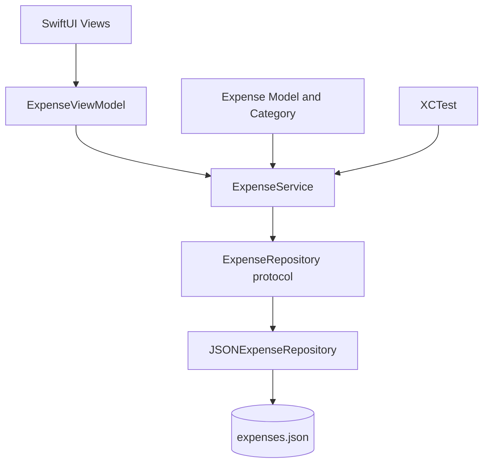

# ExpenseMate – Personal Expense Tracker

ExpenseMate is an iOS personal finance app built with **SwiftUI** and **MVVM**. It helps users record daily expenses, organize them by category, review transactions and understand spending patterns.

## 1. Problem

People often lose track of small daily purchases. ExpenseMate provides a simple local-first place to record spending and see totals without requiring an account or internet connection.

## 2. Intended users

- Students tracking food, travel and study expenses
- Individuals managing a monthly personal budget
- Anyone who wants a lightweight offline expense log

## 3. Features

- Dashboard with all-time and current-month totals
- Add an expense with title, amount, category, date and optional note
- Transaction list with category filtering
- Swipe-to-delete transactions
- Category-wise analytics, sorted by spending
- Input validation for blank titles and non-positive/invalid amounts
- Empty states for first launch and filters with no matches
- Local JSON persistence in the app's Documents directory

## 4. Architecture

The project separates platform-independent business logic from the iOS presentation layer.



- **Model:** `Expense` and `ExpenseCategory` represent transaction data.
- **Service:** `ExpenseService` owns validation, CRUD operations, totals, filtering and category aggregation.
- **Repository:** `ExpenseRepository` abstracts persistence; `JSONExpenseRepository` stores Codable data as JSON.
- **ViewModel:** `ExpenseViewModel` exposes observable state and translates UI actions into service calls.
- **Views:** Dashboard, Transactions, Add Expense, Analytics and Settings.

## 5. Folder structure

```text
capstone/
├── Package.swift
├── Sources/ExpenseMateCore/
│   ├── Models/Expense.swift
│   └── Services/
│       ├── ExpenseRepository.swift
│       └── ExpenseService.swift
├── Tests/ExpenseMateCoreTests/ExpenseServiceTests.swift
├── iOS/ExpenseMateApp/
│   ├── ExpenseMateApp.swift
│   ├── ExpenseViewModel.swift
│   ├── RootTabView.swift
│   ├── DashboardView.swift
│   ├── TransactionsView.swift
│   ├── AddExpenseView.swift
│   ├── AnalyticsView.swift
│   ├── SettingsView.swift
│   └── Components/ExpenseRow.swift
├── Documentation/architecture.mmd
├── Screenshots/
└── README.md
```

## 6. Run and test the core on Windows

Install the official Swift toolchain for Windows and make sure `swift` is available in PowerShell.

From the `capstone` directory:

```powershell
swift --version
swift test
```

The package contains platform-independent models, persistence and business logic. The XCTest suite covers empty state, add, validation, update, delete, totals, category aggregation and filtering.

## 7. Run the iOS application

**An iOS build requires macOS and Xcode.** Windows alone cannot compile or launch the SwiftUI iOS app.

On a Mac:

1. Install Xcode 15 or later.
2. Create a new iOS **App** project named `ExpenseMate` using Swift and SwiftUI.
3. Set the deployment target to iOS 16 or later.
4. Add the files under `iOS/ExpenseMateApp/` to the app target, preserving the folder organization.
5. Add this local Swift package to the Xcode project: the `capstone/` directory containing `Package.swift`. In Xcode use **File → Add Package Dependencies → Add Local** (or add the local package from the project package menu).
6. Link the `ExpenseMateCore` product to the app target.
7. Build and run on an iOS Simulator or connected iPhone.

If Xcode reports duplicate `@main` declarations, remove the generated app entry-point file from the target; use the supplied `ExpenseMateApp.swift` as the single entry point.

## 8. Test evidence

Run `swift test` from the package root. Capture the successful test summary from the terminal and save it in `Screenshots/` as `unit-tests.png`.

Recommended manual test cases on the iOS Simulator:

| # | Test | Expected result |
|---|---|---|
| 1 | First launch with no saved data | Dashboard and transactions show helpful empty states |
| 2 | Save a valid Food expense | Expense appears in dashboard and transactions |
| 3 | Save with blank title | Validation message appears; no record is saved |
| 4 | Save with amount `0` or a negative value | Validation message appears |
| 5 | Enter non-numeric amount | “Enter a valid amount” message appears |
| 6 | Filter by a category | Only matching expenses are shown |
| 7 | Delete a transaction | Row disappears and totals update |
| 8 | Add expenses in two categories | Analytics shows category totals in descending order |
| 9 | Close and relaunch the app | Previously saved expenses remain available |
| 10 | Select a category with no transactions | Helpful no-results state appears |

Do not claim a test passed until you have run it and captured the evidence.

## 9. Demo plan (2–4 minutes)

1. **0:00–0:30:** Explain the problem and show the dashboard.
2. **0:30–1:15:** Add an expense and explain validation.
3. **1:15–2:00:** Show transaction history, category filtering and deletion.
4. **2:00–2:45:** Show analytics and explain the category aggregation business rule.
5. **2:45–3:30:** Explain MVVM, service/repository separation, local persistence and unit tests.

## 10. Limitations and known issues

- No bank integration, authentication, cloud sync or multi-device backup.
- Currency is currently fixed to INR.
- No recurring transactions or budgets/alerts.
- The app UI has not been compiled or simulator-verified from Windows.
- Editing an existing transaction is supported by the core service but is not exposed as an edit screen in this initial UI.
- If the local JSON file becomes corrupted, the repository reports a load error; recovery/import tooling is not included.
- Analytics currently summarizes all recorded expenses by category; it does not yet offer a selectable date range.

## 11. Security and privacy

No API keys, private keys, passwords or credentials are used. Expense records are stored locally in the app's Documents directory. This project does not transmit financial data to a server.

## 12. Viva preparation

Be ready to explain:

- Why the app uses SwiftUI and MVVM.
- How `ExpenseService` validates and transforms the collection.
- Why persistence is abstracted behind `ExpenseRepository`.
- How category totals are calculated using `Dictionary(grouping:by:)`.
- How the tests isolate storage using a unique temporary file URL.
- What changes would be needed for cloud sync, multi-currency support and a budget feature.
