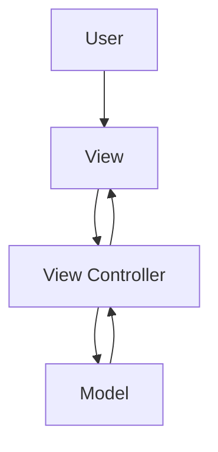
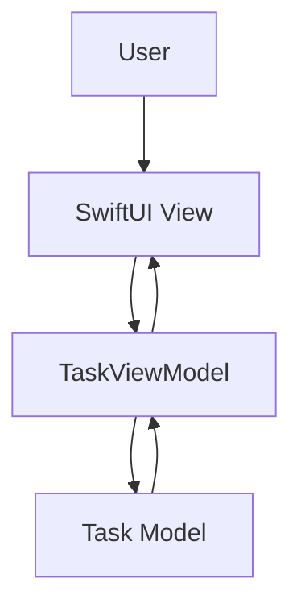

# Lab 4A: MVC and MVVM Architecture in Swift

## Overview

This project demonstrates the implementation of Model-View-Controller (MVC) and Model-View-ViewModel (MVVM) architectural patterns in Swift.

The objective is to separate user interface components, application state, and business logic to improve code organization, maintainability, and testability.

Both implementations provide the same task management functionality using different architectural approaches.

## Objectives

- Understand MVC and MVVM architectural patterns.
- Separate UI components from business logic.
- Implement task management operations.
- Move filtering and validation logic outside the UI layer.
- Compare testability and responsibility boundaries.
- Write unit tests for ViewModel logic.

## Features

Both implementations support:

- Add new tasks.
- Mark tasks as completed or active.
- Delete existing tasks.
- Filter tasks by All, Active, and Completed.
- Validate empty task names.

## Project Structure

```text
Lab-4A/
│
├── MVC/
│   ├── TaskModel.swift
│   ├── TaskListModel.swift
│   └── TaskListViewController.swift
│
├── MVVM/
│   ├── Task.swift
│   ├── TaskViewModel.swift
│   ├── TaskListView.swift
│   └── MVVMApp.swift
│
├── Tests/
│   └── TaskViewModelTests.swift
│
├── Screenshots/
│   ├── mvc-task-list.png
│   ├── mvvm-task-list.png
│   ├── validation.png
│   └── completed-filter.png
│
└── README.md
```

## Implementation Details

### 1. MVC Architecture

The MVC implementation uses UIKit.

**Components:**

- **Model:** Stores task information and manages task operations.
- **View:** Displays the task list and UI controls using UIKit.
- **Controller:** Handles user interactions and coordinates communication between the Model and View.

The controller updates the UI whenever the underlying task data changes.

### 2. MVVM Architecture

The MVVM implementation uses SwiftUI.

**Components:**

- **Task Model:** Represents individual tasks.
- **TaskViewModel:** Manages application state, validation, filtering, and task operations.
- **TaskListView:** Displays the UI and observes changes published by the ViewModel.

The ViewModel uses `ObservableObject` and `@Published` to notify the SwiftUI interface whenever relevant application state changes.

## Architecture Diagrams

### MVC



### MVVM



## MVC vs MVVM Comparison

| Criteria | MVC | MVVM |
|---|---|---|
| UI Framework | UIKit | SwiftUI |
| Main Coordinator | View Controller | ViewModel |
| Business Logic | Model | ViewModel |
| State Management | Manual coordination | Published state |
| UI Updates | Manual | Reactive |
| Testability | Model can be tested independently | ViewModel can be tested independently |
| Code Wiring | More manual wiring | Less manual UI wiring |

## Unit Testing

The MVVM implementation includes XCTest cases to verify ViewModel functionality without launching the UI.

Test cases include:

1. Adding a task successfully.
2. Validating empty task names.
3. Completing a task.
4. Deleting a task.
5. Filtering active tasks.
6. Filtering completed tasks.

## Screenshots

Add screenshots of both implementations and their functionality in the `Screenshots/` directory.

### MVC Implementation


### MVVM Implementation


### Validation


### Completed Task Filter


## Key Observations

**MVC:**
- Simple and straightforward architecture.
- The View Controller coordinates UI interactions.
- UI updates require manual handling.
- Controllers can become complex as application functionality increases.

**MVVM:**
- Better separation between UI and business logic.
- ViewModel can be tested independently of the UI.
- Reactive state updates simplify UI synchronization.
- Improves maintainability and scalability.

## Conclusion

This lab demonstrates how MVC and MVVM can be used to structure iOS applications.

Both architectures successfully implement the same task management functionality.

MVC uses a View Controller to coordinate the Model and View, whereas MVVM moves application state and business logic into a dedicated ViewModel.

MVVM offers improved separation of concerns and makes business logic easier to test independently.

## Technologies Used

- Swift
- UIKit
- SwiftUI
- Foundation
- Combine
- XCTest
- Xcode

---

**Lab:** 4A – MVC and MVVM  
**Language:** Swift  
**Focus:** Separation of UI, State, and Business Logic